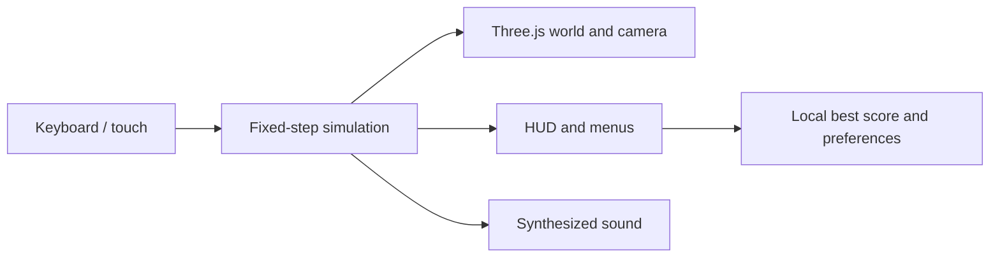

# BOOSTLINE — Flying Car Game

A mobile-first browser arcade highway stunt runner built with **TypeScript, Three.js and Vite**. Steer through traffic, jump, use limited thruster energy to fly, complete a flip or barrel roll, then land to bank points.

**Current release: v0.1.0 — playable foundation.** This release reconstructs the first development milestone from the working prototype. It is published as a new snapshot, not a recovered historical commit.

## Run locally

Use Node.js 22.18 or later and npm:

```sh
npm ci
npm run dev
```

Open the Local URL printed by Vite. In Windows PowerShell, use `npm.cmd` if `npm` is blocked by the shell policy.

### Play on your phone

1. Put the phone and computer on the same Wi-Fi network.
2. Open the project folder in VS Code and start a terminal.
3. Run `npm.cmd run dev:mobile` (or `npm run dev:mobile`).
4. Open the printed **Network** URL in the phone browser; keep the terminal running.

Use the computer's network address, not `localhost` on the phone. Allow Node.js on your private network if Windows prompts. Portrait and landscape touch layouts are supported.

## What v0.1 includes

- Original procedural coastal scenery and vehicles.
- Four-lane driving with a fixed 60 Hz simulation.
- Jump, hold-to-fly, finite energy, boost and ground recharge.
- Front flips, left/right barrel rolls and a downward slam.
- Seeded traffic, simple swept body-box collisions and close-call points.
- Clean-landing rewards, combos and distance scoring.
- Empty-road practice, pause/resume, crash results and retry.
- Personal best and sound preference saved in this browser.
- Simple synthesized engine sound and arcade event cues.
- Eight touch controls with simultaneous multi-finger input, safe-area spacing and an orientation-aware camera.

Touch buttons have a minimum 44-pixel target. Phone rendering is capped at a 1.25 device pixel ratio. Switching away from the page pauses the run and clears held inputs. Storage or audio failures do not prevent play.

## Controls

On phones, tap the lane arrows; hold **JUMP** to fly and **BOOST** to accelerate. While airborne, tap **FLIP**, **ROLL LEFT** or **ROLL RIGHT**. Hold **SLAM** to descend quickly. You can hold flight with one finger while tapping a stunt with another.

| Keyboard | Action |
| --- | --- |
| Left / right arrows or A / D | Change lane |
| Space or up arrow | Jump; hold for upward thrust |
| Shift | Hold to boost |
| F | Front flip |
| Q / E | Barrel roll left / right |
| Down arrow or S | Slam downward |
| Escape or P | Pause / resume |
| R | Restart current mode |

Complete a rotation before landing to bank its points. A hard slam breaks the combo. Practice has no traffic and forgives an unfinished rotation without awarding it. Best scores belong to this browser and address; there is no account sync.

## Architecture



| File | Responsibility |
| --- | --- |
| `src/game/simulation.ts` | Movement, traffic, collisions, energy, stunts and scoring |
| `src/game/world.ts` | Procedural scene, vehicle models and camera |
| `src/game/audio.ts` | Basic engine oscillator and short event tones |
| `src/main.ts` | Screens, input and game loop |
| `src/style.css` | Styling and responsive touch layouts |
| `src/game/simulation.test.ts` | Automated gameplay checks |
| `vite.config.ts` | Development-server configuration and private-file protection |

## Verify and build

```sh
npm test
npm run build
npm run preview
```

All 10 simulation tests pass. They cover lane bounds, pause, energy, resets, clean/unfinished/hard landings, swept collision and deterministic traffic. The build runs TypeScript checking before producing `dist/`.

Release verification also passed in headless Edge with real keyboard and multi-touch events: stunts, landing scores, boost/slam, pause and focus loss, crash/retry and saved best score. Five emulated phone viewports (320x568, 360x640, 390x844, 568x320 and 844x390) passed control-size, camera-visibility and layout checks with no browser errors. This is browser emulation, not physical-phone performance testing.

## Prototype limits

Collision uses simplified axis-aligned body bounds, with a swept check between simulation samples. Rotations expand those bounds; close passes can be conservative. Traffic is seeded with basic spacing, without a full future-route solver. Physical Android/iPhone performance, heat, sound and touch comfort still need testing. The Three.js bundle currently produces a nonfatal chunk-size warning.

Models are generated in code; no reference-game assets or footage are included. Barlow Condensed and DM Sans are bundled through Fontsource. There is no backend, online leaderboard or native/offline installation in this release.

The `.local/` directory is ignored by Git, blocked by the development server and excluded from the production build. It contains private notes and local verification artifacts and must not be force-added.
