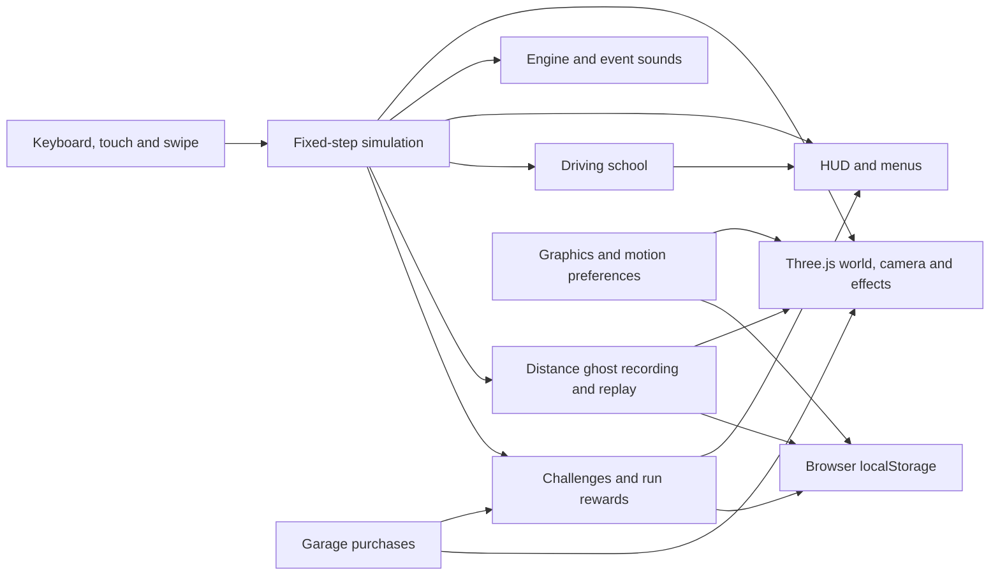

# BOOSTLINE

A mobile-first browser arcade highway stunt runner, with desktop keyboard support. Pick a lane, jump over traffic, spend thruster energy, complete a flip or barrel roll, and land to bank your points.

**Current release: v0.2.0 — the complete current prototype.** This second published release brings together the improvements developed across the earlier internal milestones through v0.6. The published sequence is v0.1.0, v0.2.0, then v0.3.0 for the next set of improvements. Existing browser-save formats stay compatible with the same gameplay rules.

## Local development

Requirements: Node.js 22.18 or later and npm.

```sh
npm ci
npm run dev
```

Open the Local URL printed by Vite. On Windows PowerShell, `npm.cmd` can be used in place of `npm`.

### Play on your phone while developing in VS Code

1. Connect the phone and this computer to the same Wi-Fi network.
2. In VS Code, open **Terminal → New Terminal** inside the project folder.
3. Run `npm.cmd run dev:mobile` (or `npm run dev:mobile` on other systems).
4. Open the **Network** URL printed in that terminal in the phone's browser. Use the computer's IP address shown there, not `localhost` on the phone.
5. Keep the terminal running. Press **Ctrl+C** when finished.

If Windows asks about Node.js network access, allow it on your private home network. If the URL cannot load, check both devices are on the same network, that a VPN or guest Wi-Fi is not isolating them, and that the firewall permits the development server on your private network. The game does not require a phone cable or an app installation.

Portrait and landscape layouts are supported. Browser emulation is used during development; physical Android Chrome and iPhone Safari playtests are still needed to judge frame rate, heat, sound and comfort on real devices.

```sh
npm test
npm run build
npm run preview
```

## Controls

On a phone, use the on-screen buttons. Swipe horizontally across the road or tap **← / →** to change lane. Each deliberate swipe changes one lane; swiping vertically does not steer. Tap **JUMP** to jump, then keep holding to fly. Hold **BOOST** for forward speed, tap **FLIP / ROLL LEFT / ROLL RIGHT** while airborne, and hold **SLAM** to descend quickly. You can hold JUMP with one finger while tapping a stunt with another. Release JUMP to fall naturally; energy refills after landing. Use the pause button to resume, restart or return home.

Desktop controls:

| Input | Action |
| --- | --- |
| A / D or left / right arrows | Change lane |
| Space or up arrow | Jump; hold to apply upward thrust |
| Shift | Hold for forward boost |
| F | Front flip while airborne |
| Q / E | Barrel roll left / right |
| S or down arrow | Slam downward |
| P or Escape | Pause / resume |
| R | Restart the current mode |

Practice flight offers an empty road; scored runs include traffic. Completed tricks are banked on a clean landing. Best scored runs are saved on the device when browser storage is available.

## Driving school and landing guidance

Choose **First drive? Learn the moves** on the home screen for an optional five-step lesson on an empty highway. It advances after actual lane changes, held flight, a completed stunt, a clean landing and held boost. Skip continues ordinary practice, and restarting a lesson starts it from the beginning. Completion is remembered on this browser, and the lesson can always be replayed.

The airborne marker shows your position on the road below. The HUD shows height, unfinished-rotation warnings and points that can be banked on a clean landing. A hard descent turns the guidance orange. These cues describe altitude, rotation and impact risk; they do not forecast traffic collisions or guarantee a safe landing. Practice forgives an unfinished rotation but does not award stunt points for it.

## Race your distance ghost

Finish a scored run to record a cyan replay car for the next attempt. The ghost follows the actual positions and rotations from your longest completed run, independently of your highest score. It cannot collide with you or traffic. The HUD compares distance at the same elapsed race time; positive progress means you are ahead. When the replay ends, the HUD shows the distance still to beat or confirms that you have passed it.

Use **Ghost on / off** on the home or pause screen. The choice persists on this browser. Recording continues when the display is off; practice and abandoned runs never replace a saved ghost. Pausing also freezes the replay clock. A saved ghost is used from the start of the next scored run.

Recordings use 10 samples per second with interpolated positions and rotations, capped at ten minutes. Longer runs still score normally and keep the previous ghost. Data stays in localStorage on the current browser and origin; changing the address or port uses a different record store. If storage fails, a new ghost remains available for the current session. Invalid or incompatible recordings are ignored. These local replays are not verified competitive records.

## Effects, sound and phone graphics

Open the sliders button beside the sound control to change graphics. Opening settings during play pauses the run and releases held controls; closing returns to play. Opening from an already paused run keeps it paused.

| Graphics | Phone pixel-ratio cap | Maximum visual particles |
| --- | --- | --- |
| Performance | 1.0 | 24 |
| Balanced (default) | 1.25 | 48 |
| Quality | 1.75 | 80 |

The actual pixel ratio never exceeds the screen density. Desktop Balanced and Quality caps are 1.5 and 2.0. Quality changes resolution and cosmetic particle density, without changing physics, traffic, scoring or replay timing. It does not promise a particular frame rate or battery improvement.

Boost and powered flight leave brief exhaust trails. Clean landings, other landings and crashes produce distinct bursts using one pooled, instanced draw call. Effects freeze on pause, expire naturally and reset between runs. The **Reduce effects** switch removes particles, landing pulses and boost camera widening; the operating system's reduced-motion preference also enables this, including changes made while the page is open. Essential traffic warnings, altitude guidance and car movement remain.

**Show frame rate** adds a small FPS counter during play, based on rendered animation frames over about a second. Use it for comparisons on your own phone; headless browser checks are not device performance measurements. Preferences save on this browser, with session-only fallback when storage is unavailable.

Sound now layers a motor, low engine tone and filtered thruster noise. Clean landings have a rising two-note cue; ordinary/hard landings use a thud, and crashes have a short impact sound. Sound uses one audio context with a bounded number of short-lived cue voices. Pause, mute and backgrounding silence the output. The game remains playable if audio cannot start. Real-device listening is needed to judge loudness and speaker quality.

## Challenges, run credits and garage

Open **GARAGE** on the home screen, or **Garage & challenges** while paused. The four original paint schemes are cosmetic: handling, flight, collisions and scoring stay identical. Coast Ivory is free; Sunset Ember costs 75 credits, Glacier Blue 160 and After Hours 260. Unlocking a colour equips it immediately, and switching owned colours is free. The cards preview the colours; the chosen paint also appears on the actual player car. Traffic and the cyan replay ghost keep their own colours.

Each scored run takes the next challenge at its start. Reach the target within that run, then finish the run in a crash to claim it. The small HUD line tracks the target; a completed target stays pending until the results screen. A run can finish at most one challenge, and each challenge bonus is claimed only once. Unfinished challenge progress resets on the next run. These are six sequential goals, not date-based challenges:

| Challenge | Target in one run | Bonus |
| --- | --- | --- |
| Stick the landing | Land 1 completed flip or roll cleanly | 60 CR |
| Coast explorer | Travel 400 m | 90 CR |
| Thread the traffic | Earn 3 close calls | 100 CR |
| Stunt collector | Land 3 completed stunts cleanly | 140 CR |
| Keep the rhythm | Reach a 4× combo | 180 CR |
| Kilometre club | Travel 1,000 m | 250 CR |

Every finished scored run earns **1 credit per full 20 metres**, **8 per cleanly landed stunt**, and **2 per close call**, plus its challenge bonus. The results screen breaks down these rewards. Base rewards continue after all six challenges. Credits are in-game points with no real-money purchases. The wallet is capped at 999,999 credits. Practice, driving school, returning to the menu and restarting an unfinished run award no credits or challenge bonuses.

The wallet, owned colours, equipped colour and completed challenges save together under `boostline.progress.v1` in localStorage. They belong to the current browser and origin; another address, port or device has its own progress. There is no account sync. Bad or unsupported saved data is recovered safely. If browser storage is blocked or full, progress and purchases work for the current session, with a visible message; reloading may lose changes that could not be saved. These local saves are not tamper-proof competitive records.

## Current milestone

This is the v0.2.0 mobile prototype. It includes original procedural vehicles and scenery, a fixed-step simulation, limited flight, stunts, spaced traffic rows, rotation-aware swept collision checks, landing rewards, local records, pause/retry, optional synthesized audio and an accessible controls dialog.

The phone layout includes all eight driving/stunt controls, simultaneous touch input, an orientation-aware follow camera, safe-area spacing and a capped render pixel ratio. Backgrounding the page pauses the game and releases held controls. This milestone targets mobile browsers; native app packaging and offline installation are future decisions.

The collision model sweeps a rotating car-body box against traffic boxes. It checks continuous movement along separating axes and splits rotation into small steps with conservative padding to catch contact between frames. Cosmetic steering yaw is omitted. These remain simplified body boxes, not mesh-level collisions or a full vehicle-physics simulation.

After four introductory vehicles, seeded traffic arrives in rows of two vehicles with two adjacent lanes open. Neighbouring rows share at least one open lane and begin at least 118 metres apart. All traffic travels at the same speed, keeping these gaps from closing. These are spacing constraints rather than a complete future-route reachability solver.

An amber **TRAFFIC AHEAD** cue highlights an approaching vehicle in your current or selected lane within roughly three seconds of contact. It turns red and says **CHOOSE A GAP** below 1.25 seconds. The flight/descent estimate is advisory: it cannot guarantee a safe route or landing. Physical phone testing is still needed to assess performance and control comfort.

Online services, verified leaderboards, shareable replays and daily challenges are future milestones.

## Architecture



The simulation runs independently of the renderer so movement, collisions, traffic and scoring can be tested without WebGL. Ghosts and visual effects do not affect collision results. Local saves are validated and have session-only fallbacks; there is no game backend.

## Verification

The v0.2.0 release passes **54 automated tests** across six test files, plus TypeScript checking and the production build. Tests cover core movement/scoring, input and lessons, traffic/collision rules, ghost replay, effects/settings/audio calculations, and progression/purchases. Physical-phone testing remains separate from browser emulation.

## Structure

- `src/game/simulation.ts`: gameplay state and fixed-step rules, independent of graphics.
- `src/game/collision.ts`: rotating body boxes and swept collision checks.
- `src/game/traffic.ts`: seeded traffic rows and spacing.
- `src/game/traffic-warning.ts`: approaching-traffic advisory.
- `src/game/ghost.ts`: bounded replay recording, validation, interpolation and distance-record selection.
- `src/game/world.ts`: Three.js scene, procedural assets and camera.
- `src/game/audio.ts`: layered synthesized engine/thruster sound and landing/impact cues.
- `src/game/effects.ts`: fixed particle pool for exhaust trails and event bursts.
- `src/game/settings.ts`: validated graphics preferences and per-device render budgets.
- `src/game/progression.ts`: validated local career save, one-time run rewards, sequential challenges and cosmetic purchases.
- `src/game/progression.test.ts`: real-run rewards, claim boundaries, practice/retry exclusions, wallet bounds and purchase persistence.
- `src/game/feedback.test.ts`: settings recovery, effect lifecycle/bounds and audio-mix checks.
- `src/game/swipe.ts`: horizontal touch gesture recognition.
- `src/game/training.ts`: optional driving-school progress.
- `src/game/flight-assist.ts`: rotation and descent guidance.
- `src/main.ts`: interface, input, run lifecycle and browser integration.
- `src/game/simulation.test.ts`: tests for movement, scoring, resets and collision behaviour.
- `src/game/traffic.test.ts`: collision precision, traffic spacing and warning checks.
- `src/game/ghost.test.ts`: replay lifecycle, interpolation, validation and recording limits.
- `src/game/controls.test.ts`: swipe intent, tutorial integration and landing guidance checks.

## Data and assets

Models are generated in code. No external game assets or reference-video footage are included. Barlow Condensed and DM Sans are bundled locally through Fontsource, with system-font fallbacks. Best score, distance ghost, ghost visibility, graphics preferences, sound preference, tutorial completion and career/garage progress use localStorage; no data is sent to a game backend.

The `.local/` directory is intentionally ignored by Git, blocked by the Vite development server and absent from the build output. It is reserved for personal notes and local verification artifacts. Do not force-add its contents or copy it into `public/`.
